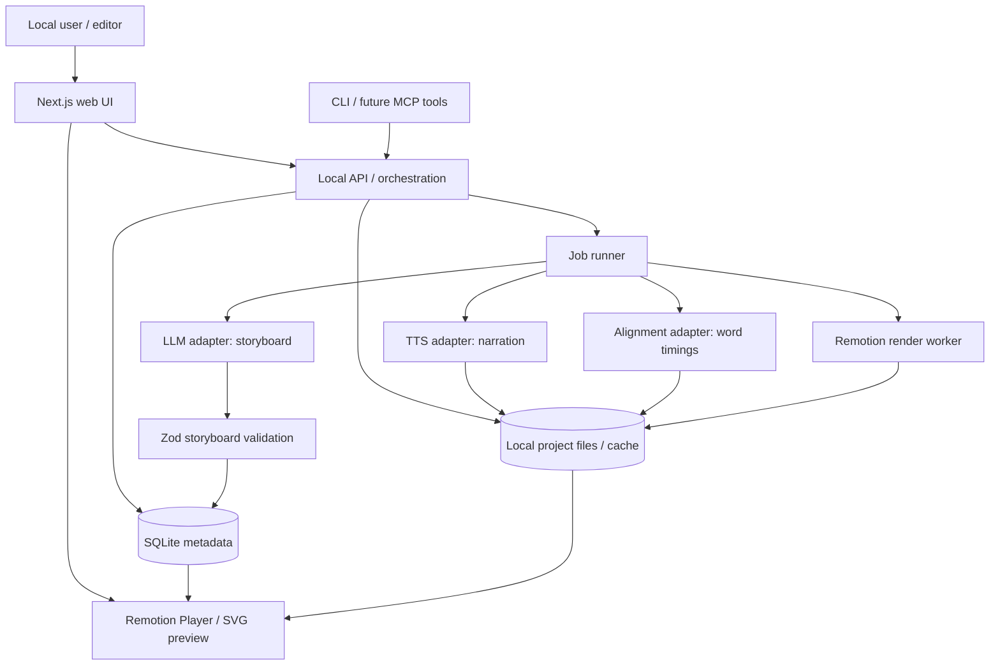

# Technical Design Document — AI Technical Explainer Studio
**Version:** 1.0 · **Status:** Proposed / agent implementation baseline · **Date:** 2026-10-23

## 1. Executive summary
Build a **local-first**, reusable pipeline that turns technical prose into editable, narrated, animated explainers. The LLM generates a structured, validated storyboard. A deterministic React/SVG + Remotion engine handles diagram layout, animation, subtitles, and video rendering. Narration comes from a swappable TTS provider; forced alignment maps spoken words to timestamps. Local-first MVP precedes SaaS, authentication, billing, and collaboration.

### Goals
- Turn technical article or pasted Markdown into an editable multi-scene storyboard.
- Consistent, polished diagrams and smooth animation from reusable templates and presets.
- Indonesian narration, technical term pronunciation controls, and synchronized subtitles/highlights.
- Editable themes, text, node labels, scene sequence, narration, and timing without rerunning the LLM.
- Render reproducible 1080×1920 MP4 at 30 fps; preview individual scenes quickly.
- Cache expensive outputs (LLM, TTS, alignment, assets) and enable deterministic rerender.

### Non-goals (MVP)
Multi-user SaaS, payments, freeform Canva-like canvas, real-time collaboration, arbitrary 3D, avatar/video diffusion, automated publishing, image generation, enterprise permissions, marketplace, and fully autonomous quality approval.

## 2. Architecture and boundaries

**Separation of concerns:** The LLM may choose from allowed scene types, node types, motion presets, and theme IDs, but cannot supply arbitrary HTML/JS/CSS to execute. The rendering engine owns all positions, connectors, easing, frame timing, and theme token application. TTS/audio, alignment, and video rendering are distinct jobs.

## 3. Suggested stack (decisions to confirm at bootstrap)
- **Monorepo:** pnpm workspaces + TypeScript, Node.js LTS supported by chosen Remotion version.
- **Frontend:** Next.js + React + Tailwind; Remotion Player for preview.
- **Video engine:** Remotion + SVG, `interpolate`/`spring`; no dependence on browser wall-clock timers for export.
- **Schema validation:** Zod; JSON Schema exported for AI structured output.
- **Database:** SQLite + Drizzle ORM for local MVP; PostgreSQL later if SaaS.
- **Jobs:** simple persistent SQLite-backed job runner or separate Node worker. Avoid Redis/BullMQ initially.
- **Audio:** provider interface; start with one cloud Indonesian TTS provider; FFmpeg for probe, trim, normalization and muxing.
- **Alignment:** provider adapter (e.g. WhisperX local or a supported timestamp API); accuracy must be tested on Indonesian + English technical terms.
- **Testing:** Vitest for schemas, layouts and frame math; Playwright smoke tests for editor; render frame snapshot regression tests.
- **Observability:** structured JSON logs, job status and error details; no external monitoring required in MVP.

## 4. Repository layout
```text
technical-explainer/
  apps/
    web/                    # project list, editor, preview, job status
    cli/                    # init, validate, generate, narrate, align, render
  packages/
    schema/                 # Zod schemas, types, migrations
    storyboard/             # prompt templates, provider adapter, validation
    diagrams/               # nodes, connectors, auto-layout
    motion/                 # motion presets, camera, event particles
    themes/                 # tokens, theme presets, fonts
    audio/                  # TTS, pronunciation, alignment, captions
    renderer/               # Remotion compositions, output profiles
    core/                   # orchestration, caching, job states
  examples/
    postgres-cdc/           # golden sample project
  tests/
  docs/
```

## 5. Canonical project and scene data model
A project has: `id`, `title`, `sourceText`, `language`, `aspectRatio`, `fps`, `themeId`, `sceneIds`, `revision`, `createdAt`, `updatedAt`.
A scene has: `id`, `order`, `type`, `title`, `narrationText`, `durationFrames`, `nodes[]`, `edges[]`, `animationCues[]`, `cameraCues[]`, `subtitleSettings`, `audioAssetId`, `alignmentAssetId`, `overrides`, `revision`.
An asset has: `id`, `type`, `localPath`, `sha256`, `provider`, `providerModel`, `generationParams`, `createdAt`.
A job has: `id`, `type`, `projectId`, `sceneId?`, `status` (`queued|running|succeeded|failed|cancelled`), `progress`, `error`, `startedAt`, `completedAt`, `attempts`.

### Example storyboard (illustrative; final Zod schema is source of truth)
```json
{
  "schemaVersion": 1,
  "project": {"title": "How PostgreSQL CDC Works", "language": "id-ID", "fps": 30, "aspectRatio": "9:16", "themeId": "midnight-tech"},
  "scenes": [{
    "id": "wal-intro", "order": 1, "type": "data-flow", "title": "Write-Ahead Log",
    "narrationText": "PostgreSQL mencatat perubahan data dalam Write-Ahead Log.",
    "durationFrames": 180,
    "nodes": [
      {"id": "db", "kind": "database", "label": "PostgreSQL"},
      {"id": "wal", "kind": "log", "label": "WAL"}
    ],
    "edges": [{"id": "db-wal", "from": "db", "to": "wal", "kind": "data-flow"}],
    "animationCues": [
      {"id": "reveal-db", "preset": "node-reveal", "targetId": "db", "startFrame": 0, "durationFrames": 24},
      {"id": "draw-wal", "preset": "connector-draw", "targetId": "db-wal", "startFrame": 18, "durationFrames": 40},
      {"id": "flow-wal", "preset": "event-travel", "targetId": "db-wal", "startFrame": 60, "durationFrames": 48}
    ]
  }]
}
```
**Validation:** enforce unique IDs, valid edge endpoints, permitted presets/types, nonnegative frame starts, positive durations, cue end <= scene duration, maximum node count per scene, and safe string lengths. Reject invalid generated JSON; retry with validation errors at most twice, then request manual repair. Version schema and provide migrations.

## 6. AI storyboard generation
**Inputs:** source article, target audience, duration range, language, desired video orientation, allowed component/preset catalog.
**Outputs:** high-level scene outline, narration per scene, canonical diagram nodes/edges, animation intent, source fact mapping, estimated duration. Use structured JSON output and schema validation.
**Workflow:** (1) extract claims/key concepts, (2) produce scene outline, (3) human reviews technical accuracy, (4) generate detailed storyboard, (5) validate schema and renderability, (6) edit in UI. Do not assert facts absent from source without marking as suggestions for review. For CDC specifically, distinguish WAL, logical decoding, replication slot, Debezium, Kafka, and consumer.
**Quality guardrails:** cap scene complexity, ensure legible typography, prevent overlap, use deterministic auto-layout, warn on overcrowded scenes, avoid arbitrary generated CSS and JS.

## 7. Layout, theme and motion engine
**Layout:** start with three scene templates: `horizontal-data-flow`, `comparison`, `focus-explain`. Define safe areas for 9:16, padding, maximum nodes, label wrapping, minimum text size, collision checks, edge routing. Layout is derived from schema and viewport, with optional explicit position overrides validated against safe bounds.
**Theme:** design tokens: background, surface, text, muted, accent, secondary, strokeWidth, nodeRadius, fontFamily, shadow, connectorStyle. Ship `midnight-tech`, `clean-light`, `hand-drawn` (hand-drawn requires separate renderer/rough SVG styling). Theme changes must not alter semantic graph.
**Motion presets:** `node-reveal`, `connector-draw`, `event-travel`, `node-pulse`, `focus-camera`, `caption-emphasis`. All functions must be pure functions of `(frame, fps, cue, layout)`; avoid `setTimeout`, nonseeded randomness and runtime animation clocks in exported video. Ease/spring with capped overshoot; cues may overlap.
**Video:** initial output 1080×1920, 30 fps, H.264 MP4, AAC audio. Preview at lower resolution, render full resolution only on export. Support no-audio fallback.

## 8. Audio and synchronization pipeline
1. User approves or edits `narrationText` per scene.
2. Generate TTS **per scene**, cache by hash of normalized text + provider + voice + settings + pronunciation lexicon.
3. Probe actual audio duration with FFmpeg/ffprobe; do **not** trust estimated speech duration.
4. Run forced alignment against exact approved transcript to obtain word-level `(startMs, endMs)`; preserve confidence/warnings.
5. Convert time to frames: `startFrame = round(startMs / 1000 * fps)`; account for scene audio lead-in and scene timeline offset.
6. Resolve semantic anchors (`PostgreSQL`, `WAL`, etc.) to matched word spans; attach cues to anchor IDs. Use phrase matching and manual override for uncertain alignments.
7. Set scene duration to actual narration duration plus configured pre/post-roll; if animations exceed duration, reschedule or flag for editor—do not silently clip.
8. Generate subtitles from alignment, grouping into short readable phrases. Render captions using deterministic frame intervals.
9. Mix voice/music with consistent loudness; ensure voice remains intelligible. Render and verify audio-video sync.

**Important:** Forced alignment is not guaranteed accurate for Indonesian technical jargon; expose per-scene timing editor. If aligner fails, fall back to phrase timing/manual timing with a visible warning. Never claim word-exact synchronization without verified alignment.

### Audio data example
```json
{
  "sceneId": "wal-intro", "audioDurationMs": 4200,
  "words": [
    {"text": "PostgreSQL", "startMs": 320, "endMs": 1110, "confidence": 0.93},
    {"text": "mencatat", "startMs": 1180, "endMs": 1680, "confidence": 0.97}
  ],
  "anchors": [{"key": "db-highlight", "wordStartIndex": 0, "wordEndIndex": 0}]
}
```

## 9. Local API and CLI contract
API routes (implementation may use Next.js route handlers):
- `POST /api/projects` create project from title/source text.
- `GET /api/projects/:id` retrieve project and scene revisions.
- `PATCH /api/projects/:id` update metadata/theme.
- `PUT /api/projects/:id/scenes/:sceneId` update a scene with optimistic revision check.
- `POST /api/projects/:id/storyboard` enqueue AI storyboard job.
- `POST /api/projects/:id/scenes/:sceneId/narration` enqueue TTS and alignment.
- `POST /api/projects/:id/render` enqueue MP4 render.
- `GET /api/jobs/:jobId` get status/progress/errors.
- `GET /api/projects/:id/assets/:assetId` read permitted local asset.

CLI examples:
```bash
pnpm studio init --title "PostgreSQL CDC"
pnpm studio storyboard --project ./projects/postgres-cdc
pnpm studio validate --project ./projects/postgres-cdc
pnpm studio narrate --project ./projects/postgres-cdc
pnpm studio align --project ./projects/postgres-cdc
pnpm studio preview --project ./projects/postgres-cdc
pnpm studio render --project ./projects/postgres-cdc --out ./out/cdc.mp4
```
CLI should emit machine-readable JSON status and meaningful nonzero exit codes. CLI is the stable surface to expose through MCP **later** (`list_components`, `get_component_schema`, `validate_storyboard`, `preview_scene`, `render_video`). No MCP server required for first milestone.

## 10. Data lifecycle, caching, and reproducibility
- Keep editable project/scene JSON and versioned assets. Never overwrite source audio or final exports silently.
- Cache storyboard by source hash + prompt version + model config; cache TTS by script/voice/settings; cache alignment by audio hash + transcript + aligner version.
- Any narration edit invalidates TTS, alignment, subtitles, and relevant timing; theme edit invalidates preview/render only; node-label edit invalidates scene visual render but not audio unless narration changes.
- Pin dependencies and record renderer version, schema version, theme version, fonts, export profile, and source asset hashes in render manifest.
- Atomic write temporary files then rename on success; clean up failed render temp files.

## 11. Security, privacy and cost controls
- Local MVP binds API to localhost by default. If exposed remotely, add authentication, CSRF protections, and strict origin rules.
- API keys only in server-side environment variables; never embed keys in project JSON or frontend bundles.
- Treat imported documents, LLM outputs, SVG assets and prompts as untrusted; no `eval`, arbitrary code execution, unsanitized HTML, or user-supplied file paths.
- Validate uploads, MIME, sizes, local path traversal and command arguments. Use argument arrays for FFmpeg/Remotion subprocesses.
- Prompt injection defense: source content is data, not instructions; restrict model output to schema.
- Cost controls: max input tokens, scene count, TTS characters, render resolution and job concurrency; log estimated/provider-reported usage where available.
- Before commercial SaaS launch: verify TTS voice licensing, font/icon licenses, privacy policy, user data retention, and music rights.

## 12. Editor UX (MVP)
Project dashboard -> source input -> AI scene outline -> storyboard editor -> narration review -> theme selector -> per-scene preview -> TTS/alignment -> timeline adjustment -> export. Scene editor shows node labels, connections, narration, preset selection, audio waveform/timing markers and validation warnings. Support undo for user edits or explicit revision history. Show stale audio when narration text changes. Keep freeform drag/drop out of MVP.

## 13. Testing and acceptance criteria
**Unit:** schema validation, unique graph IDs, edge routing, layout collision checks, frame/time conversion, cue bounds, cache keys, dependency invalidation.
**Integration:** fake LLM/TTS/alignment providers; job persistence, retry/idempotency, missing provider key, TTS failure, invalid model JSON, corrupted audio, render failure.
**Visual regression:** representative frames at beginning/middle/end of each preset/theme; 9:16 safe-area and legibility checks.
**Golden sample:** PostgreSQL CDC project with >=3 scenes, Indonesian narration, PostgreSQL/WAL/Debezium/Kafka, animated event path, timed captions, theme switch and successful export.

**Definition of done for MVP:**
- Source Markdown produces schema-valid, editable storyboard (with human review).
- User can modify node labels, narration, theme, and animation preset without rerunning AI.
- TTS and alignment produce usable per-scene audio and timing metadata; manual correction available.
- 1080×1920, 30fps MP4 export succeeds locally and is reproducible for identical inputs.
- Video has no clipped labels, missing nodes, broken connectors, or unintended audio cutoffs in golden sample.
- Editing only theme does not call TTS or LLM; editing only narration invalidates appropriate dependent artifacts.
- Failed jobs are recoverable and actionable error messages are visible.

## 14. Agent implementation plan
**Phase 0 — Scaffold and contracts:** monorepo, Zod schemas, example CDC JSON, test harness, ADRs, README. Deliverable: `pnpm test` and `pnpm studio validate` work.
**Phase 1 — Deterministic visuals:** node/edge components, three layouts, three themes, six motion presets, Remotion composition and preview. Deliverable: render CDC video with placeholder captions, no AI/audio dependency.
**Phase 2 — Storyboard generation:** LLM adapter, structured output, validation/repair, project editor, revisions. Deliverable: article -> editable storyboard.
**Phase 3 — Narration and sync:** TTS adapter, caching, ffprobe, alignment, anchor mapping, subtitle renderer, manual timing overrides. Deliverable: narrated CDC MP4.
**Phase 4 — Reliability and quality:** render jobs, error handling, regression screenshots, audio QA, cost logs, UX polish. Deliverable: golden sample passes acceptance criteria.
**Phase 5 (optional) — MCP:** wrap CLI/API in MCP tools, add discoverability and capability schemas. **Phase 6 (later) — SaaS:** auth, organizations, billing, object storage, queues, quotas, isolation and audit logs only after customer validation.

### Agent delegation guidance
- **Architect agent:** own ADRs, package boundaries, schema/API contracts; do not implement UI.
- **Motion agent:** own diagrams/motion/renderer and golden-frame tests.
- **AI agent:** own prompt contracts, LLM adapter, schema validation, retry and fact traceability.
- **Audio agent:** own TTS, aligner, timing/caption tests and cache invalidation.
- **Frontend agent:** own editor UX and API integration.
- **QA agent:** own integration/e2e/golden-sample validation.

### Agent operating rules
1. Read this TDD and existing code before editing. Create a short implementation plan.
2. Respect package ownership; propose cross-package contract changes before changing them.
3. Prefer pure functions and typed interfaces; never generate arbitrary executable code from LLM output.
4. Implement one vertical slice at a time, with tests and a runnable example.
5. Report changed files, tests executed, known limitations and follow-up work.
6. Do not claim feature completeness based solely on successful compilation; validate rendered frames and audio.

## 15. Open decisions to resolve before implementation
1. **TTS provider:** compare Indonesian naturalness, technical pronunciation, commercial rights and API price; no provider is assumed free for commercial use.
2. **Alignment:** test Indonesian code-switching with real narration; choose local vs hosted based on quality and resource budget.
3. **LLM provider:** choose structured-output-capable model and budget cap; keep adapter swappable.
4. **Scene timing:** whether generated storyboard uses approximate durations before audio, then actual durations after TTS (recommended).
5. **Visual identity:** finalize one premium dark theme and animation choreography as reference before adding many styles.
6. **Deployment:** local-only initially; no SaaS infrastructure until validated.

## 16. First agent task (copy/paste)
> Implement Phase 0 and Phase 1 of `technical-explainer-tdd-v1.md` in a pnpm TypeScript monorepo. Create versioned Zod project/scene schemas and a PostgreSQL CDC sample; implement deterministic SVG diagram nodes, connectors, six animation presets, three scene layouts, three themes, Remotion Player preview, and a CLI that validates and renders a 9:16 30fps MP4. Include tests for schema validation, edge endpoints, cue bounds, and frame determinism. Do not add LLM, TTS, auth, payments, Redis, or MCP yet. Produce a runnable README, example render command, and a short report of limitations. Keep components reusable and use only frame-based animation for exported video.
