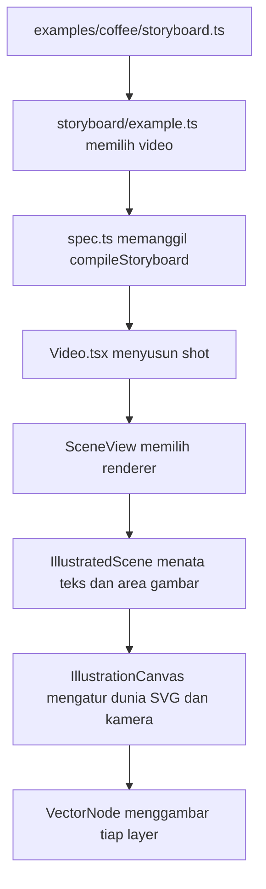

# Peta kode MotionLab

Mulai dari contoh video, lalu ikuti datanya menuju renderer. Nama file berikut relatif terhadap root repository. Untuk pemakaian sehari-hari, baca [workflow](WORKFLOW.md).

## Mulai dari sini

1. **`src/examples/coffee/storyboard.ts`** — narasi, judul, caption, durasi dan urutan shot.
2. **`src/examples/coffee/cues.ts`** — urutan waktu kejadian, seperti loading → docking → extraction.
3. **`src/examples/coffee/shots/`** — satu file per shot: `beans.ts`, `extraction.ts`, `espresso.ts`.

`shared.ts` berisi bagian yang dipakai beberapa shot, misalnya cangkir dan animasi pengisiannya. Pemanggilannya memakai opsi bernama: `x`/`y` untuk posisi, `scale` untuk ukuran, `fillStart`/`fillEnd` untuk waktu pengisian.

## Alur source menjadi video

`src/root.tsx` mendaftarkan film, shot dan galeri aset sebagai komposisi Remotion. Full film dan preview shot memakai implementasi scene yang sama.

## Istilah utama

- **Layer/node:** satu bagian yang bisa bergerak sendiri, misalnya jarum atau cairan.
- **Asset:** ilustrasi yang bisa dipakai berulang dengan posisi berbeda.
- **Shot:** satu potongan cerita dengan objek, teks dan durasi.
- **Cue:** kejadian bernama yang menjadi acuan waktu aksi lain.

Saat mengedit, waktu ditulis dalam detik lokal shot. Engine menerjemahkannya ke frame dan menghitung tampilan dari frame saat ini.

## Mau ubah apa?

| Perubahan                                     | File utama                          |
| --------------------------------------------- | ----------------------------------- |
| Script, headline, caption, urutan shot        | `src/examples/coffee/storyboard.ts` |
| Kapan sebuah aksi dimulai                     | `src/examples/coffee/cues.ts`       |
| Posisi dan gerakan objek                      | `src/examples/coffee/shots/*.ts`    |
| Cangkir dan pengisiannya yang dipakai bersama | `src/examples/coffee/shared.ts`     |
| Bentuk aset kopi                              | `src/illustration/assets/coffee.ts` |
| Pendaftaran dan metadata aset                 | `src/illustration/registry.ts`      |
| Palet warna                                   | `src/illustration/style.ts`         |
| Default ukuran HP dan margin aman             | `src/render/config.ts`              |
| Layout portrait/square/landscape              | `src/illustration/layout.ts`        |
| Perhitungan animasi dan motion preset         | `src/illustration/motion.ts`        |

## Kalau perlu masuk ke engine

- `src/storyboard/`: validasi dan compile storyboard. Subfolder `timing/` menyelesaikan cue, referensi waktu dan ikatan animasi.
- `src/illustration/rendering/`: canvas SVG, render setiap node, clipping, paint dan path.
- `src/scenes/`: pilihan renderer. Jalur ilustrasi dan Three.js tetap tersedia.
- `scripts/preview/`: baca opsi → pilih frame → render PNG → bangun report. `scripts/preview-report.mjs` mengatur urutan langkah tersebut.

`src/storyboard/example.ts`, `src/illustration/coffee-benchmark.ts` dan `src/storyboard/timeline.ts` adalah pintu masuk ringkas yang mempertahankan import lama. Edit file implementasi yang mereka tuju ketika ingin mengubah perilaku.

Setelah mengedit, jalankan `npm run check`. Kalau tampilan berubah, periksa preview frame yang relevan juga. Daftar detail API dan aturan kerja agent ada di paket skill, sementara panduan ini membantu kamu menemukan bagian kode yang perlu diubah.
